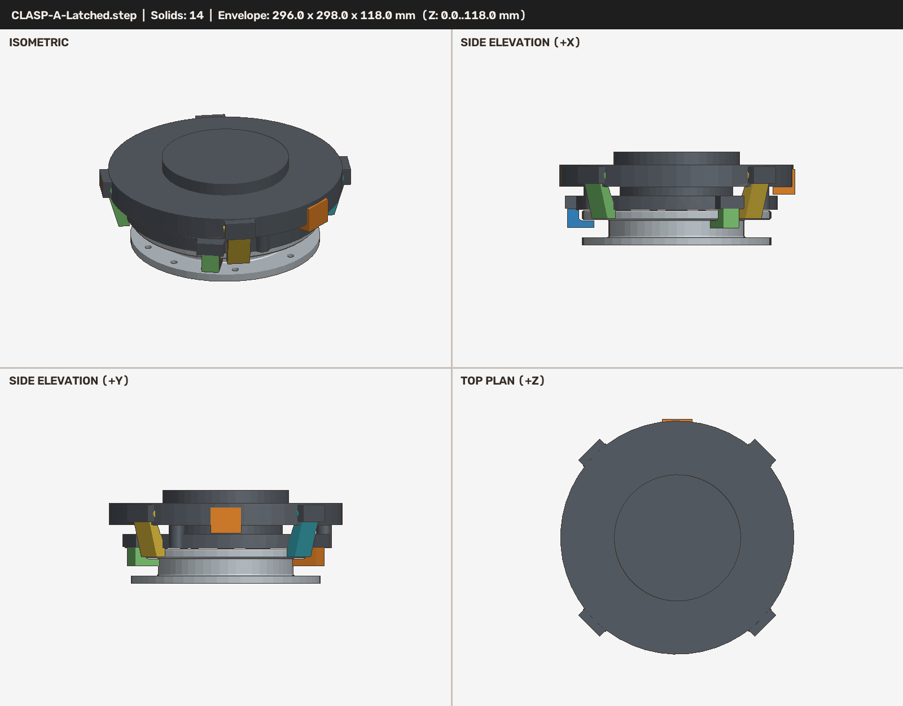

# CLASP — Common Lunar Attachment and Servicing Port

**The shipping-container corner casting for the Moon:** an open, royalty-free passive mechanical, cryogenic fluid, and contactless power/data interface standard (`CLASP-STD-001`) for lunar cargo handling, cryogenic refueling, and rover/depot servicing below crewed IDSS scale.

[Specification (PDF)](CLASP-STD-001_RevA_Working_Draft.pdf) · [How It Works](#how-it-works-in-60-seconds) · [Three-Tier Architecture](#one-port-three-tiers) · [Verified Baseline](#what-is-already-proven) · [Engineering Deep-Dive](#engineering-deep-dive)


---

## Why This Exists: The Lunar Logistics Bottleneck

Modern planetary landers, rovers, science payloads, and propellant depots face three costly realities on the lunar surface:

1. **Every mission invents custom hardware:** Landers, rovers, and cargo pallets design bespoke grapple fixtures and fluid/power connectors—adding non-recurring cost and preventing cross-vendor servicing.
2. **Lunar dust destroys electrical pins:** Fine, abrasive, electrostatically charged regolith jams latches and shorts exposed electrical contacts within a few mate cycles.
3. **Polar darkness and cryogenic boil-off:** At the lunar south pole, the Sun skims `0.5°–5°` above the horizon, casting pitch-black shadows that blind standard cameras, while unstandardized liquid oxygen (`LOX`) connectors lose `5–10%` of propellant to chilldown boil-off.

### The ISO 1161 Commercial Model

Containerization transformed global shipping not because one company patented a steel box, but because **every ship, crane, and truck standardized the passive corner casting**.

CLASP applies the same economics to cislunar and lunar surface logistics:
- **Open, royalty-free payload port (`CLASP-M`):** Dumb, zero-electronics metal manufacturable for well under `CAD 2,000` (`$380.02 USD` Qty-1 commercial `6061-T6` benchtop quote; `2.050 kg` flight `7075-T6` design), so payload builders can adopt it without friction or vendor lock-in.
- **High-margin active & specialty systems:** All motors, sensors, illumination, robotics, cryogenic couplings, polar-shadow computer vision, and qualification rigs live on the **active servicing side (`CLASP-A`)** and upgrade cartridges (`CLASP-F` / `CLASP-FP`).

---

## How It Works (In 60 Seconds)

One standardized robotic end effector (`CLASP-A`) captures and services any passive port (`CLASP-M`, `CLASP-F`, or `CLASP-FP`) in five steps:

1. **See in the dark:** An off-axis camera and LED ring on the robot wrist lock onto `5` passive retroreflective markers and read a laser-etched DataMatrix ID (`[CLASP-140]`–`[CLASP-141]`)—looking up payload contents, fill level, and cycle history in an off-port fleet ledger with **zero electronics or batteries on the payload port**.
2. **Catch wide misalignment:** Four wide-scoop jaws on `CLASP-A` absorb up to `±100 mm` lateral offset, `±50 mm` axial offset, and `±15°` pitch/yaw tilt without jamming—buying operational reliability in mechanics rather than fragile vision assumptions.
3. **Clear the dust:** Base cargo ports (`CLASP-M`) use mechanical covers and self-wiping chamfers; fluid/power ports (`CLASP-F`/`-FP`) trigger a contactless `1 kV` electrostatic dust shield (EDS) followed by a `0.5 g` dry-gas purge pulse before seal contact.
4. **Align and hard-lock:** Three `15°` alignment ramps draw both halves coaxial as the end effector retracts, and three `17-4PH H900` over-center positive latches lock the `10 kN` structural preload—never relying on cam friction in vacuum/dust.
5. **Transfer cryo fuel, power & data safely:** Only after positive hard-latch confirmation can mechanical interlocks open the `25 mm` coaxial `LOX` poppets (`CLASP-F`) or magnetic/Hall interlocks energize the contactless `500 W` inductive coil and `10 Mbit/s` optical link (`CLASP-FP`).


---

## One Port, Three Tiers

All three passive payload tiers share a single **`240 mm OD × ≤ 55 mm H`** footprint, **`8 × M8`** clocked mounting bolt circle (`210 mm BCD`), external perimeter grapple collar, **`3 × 15°`** alignment ramps, and **`Ø 148 mm`** internal bay—so one common **`CLASP-A`** manipulator handles cargo, power taps, and propellant tanks interchangeably:

| Hardware / Tier | Mission Role & Capability | Verified Mass (`Limit`) | Key Interfaces & Safeguards |
|---|---|---:|---|
| **`CLASP-M`** *(Passive Mech.)* | Cargo pallets, science skids, structural tie-down (`10 kN` axial, `5 kN` shear, `2.0 kN·m` bend, `1.0 kN·m` torsion — sized for `≤ 2,000 kg` lunar payloads) | `2.132 kg` base / `2.050 kg` DFM (`≤ 3.50 kg`) | Zero pins, zero power, `< CAD 2,000` 2-setup lathe/3-axis DFM; passive cover & wiping chamfers |
| **`CLASP-F`** *(+ Cryo Fluid)* | `CLASP-M` + `25 mm` coaxial dual-poppet `LOX` coupling (`90 K`, `2.0 kg/s`, `2.0 MPa` MEOP, `≤ 5 cm³` trapped volume, `2.0 mm` chilldown bypass) | `3.158 kg` (`≤ 6.00 kg`) | `4` tangential `Ti-6Al-4V` flexure spokes (`3.0 W` leak); mechanical poppet inhibit + `1 kV` EDS / purge |
| **`CLASP-FP`** *(+ Power & Data)* | `CLASP-F` + `500 W` inductive power (`≥ 85%` eff) + `10 Mbit/s` full-duplex optical link inside the same `Ø 148 mm` bore | `3.691 kg` (`≤ 7.50 kg`) | **Zero exposed electrical contacts**; magnetic/Hall power enable; `28/28` zero-overlap B-Rep checks |
| **`CLASP-A`** *(Active End Effector)* | Wrist manipulator (`4`-jaw scoop funnel, `3` cam followers, `3` `17-4PH` hooks, off-axis vision pod, active `CLASP-FP` core) | `4.81 kg` mech / `8.40 kg` w/ FP core | `Ø 486.6 mm` capture keep-out above `Z = 18.0 mm`; verified zero interference across `±100 mm / ±15°` |

---

## What Is Already Proven

While pre-hardware (`TRL 2 → 3`), the full digital engineering twin—specification, parametric 3D CAD, high-order structural and cryogenic thermoelastic FEA, commercial CNC quoting, synthetic polar vision, and C++20 fleet software—is built and continuously verified:

| Domain | Proof Completed | Headline Result |
|---|---|---|
| **Open Standard & CI** | Complete Interface Definition Document (`CLASP-STD-001` Rev A), 62-requirement Verification Matrix (`Annex A`), and automated spec linter | **`62/62` reqs**, `0` lint/parity errors in CI |
| **DFM Cost & Packaging** | Two-setup CNC lathe + 3-axis mill port ([cad/clasp_m_dfm.py](cad/clasp_m_dfm.py)) quoted commercially; full internal subsystem packaging + `4`-jaw `CLASP-A` capture kinematics | **`$380.02 USD`** Qty-1 `6061-T6` DFM quote; `28/28` bore & `5/5` extreme capture checks |
| **Discrete & Prying FEA** | `12`-angle clocking sweep (`92k` DOFs, `Tet10`) with discrete `3`-latch/`3`-cam contact patches, `15 kN/bolt` preloaded `M8` springs, and nonlinear deck lift-off | Flight **`Al 7075-T6` PASS** at worst `270°` clock (`+0.51` hot `MoS_y`); `6061-T6` scoped to cold benchtop only |
| **Mechanism & Cryo FEA** | `CLASP-A` hook & arm `Tet10` FEA + `126k`-DOF coupled `90 K` LOX vs. `83 K..+120 °C` heat-conduction & thermoelasticity | `17-4PH` hooks **`+0.77`**, arms **`+0.66`** hot `MoS_y`; tangential `Ti-6Al-4V` flexures **`3.0 W`** leak / **`+3.28` cold `MoS_y`** |
| **Polar Vision & Ledger** | `100`-trial lunar south-pole capture simulation (`0.5°–5°` sun elevation, solar glints, `21` occluded-marker trials) wired to C++20 SQLite fleet ledger | **`99.0%`** pose lock (`95.24%` occluded), **`0.005 mm` / `0.004°`** median error, `95.0%` DataMatrix decode |

### Next Milestones (`TRL 3 → 4` Benchtop Validation)

1. **Benchtop Passive + Polar Vision Rig:** Machine `CLASP-M-DFM` test articles (`Al 6061-T6` vision rig + North American `Al 7075-T6` AS9100 flight-traceable lot quotes), build a perimeter LED/camera rig matching `CLASP-A` keep-outs, and validate C++20 pose locking under grazing light and `LHS-1` lunar regolith simulant.
2. **Active `4`-Jaw / `3`-Latch Hardware Testbed:** Fabricate a single-unit `CLASP-A` mechanism (`Al 7075-T6` jaws + `17-4PH H900` hooks) on a 6-DOF compliant stage to demonstrate jam-free capture and static pull verification at all extreme `±100 mm / ±15°` corners.
3. **Cryogenic & Dusty-TVAC Pathfinding:** Validate the `Ti-6Al-4V` tangential flexure cartridge in `LN₂` (`77 K`) thermal shock and dual-poppet bypass chilldown cycling ahead of `CLASP-STD-001` Revision B freeze.

---

## Engineering Deep-Dive

- **Specification & Verification:**
  - [CLASP-STD-001_RevA_Working_Draft.md](CLASP-STD-001_RevA_Working_Draft.md) ([PDF](CLASP-STD-001_RevA_Working_Draft.pdf) via [tools/build_pdf.py](tools/build_pdf.py)) — `62` numbered requirements across `40` sections/subsections.
  - [Annex_A_Verification_Matrix_Draft.md](Annex_A_Verification_Matrix_Draft.md) — Verification Cross-Reference Matrix (`T / A / I / D`).
  - [tools/clasp_check.py](tools/clasp_check.py) — Zero-dependency spec linter, Annex A parity checker, and first-principles sizing checks.
- **Parametric CAD (`build123d`) & Visual Inspection:**
  - [cad/clasp_m.py](cad/clasp_m.py) → [cad/CLASP-M.step](cad/CLASP-M.step) (`2.132 kg`, `758.60 cm³`).
  - [cad/clasp_m_dfm.py](cad/clasp_m_dfm.py) → [cad/CLASP-M-DFM.step](cad/CLASP-M-DFM.step) (`2.050 kg`, `729.39 cm³` — 2-setup CNC lathe + top-down 3-axis mill).
  - [cad/clasp_fp_packaging.py](cad/clasp_fp_packaging.py) → [cad/CLASP-FP-Packaging.step](cad/CLASP-FP-Packaging.step) (`28/28` zero-overlap B-Rep checks inside `Ø 148 mm` bore; `4` tangential `Ti-6Al-4V` flexure spokes; `CLASP-F = 3.158 kg`, `CLASP-FP = 3.691 kg`).
  - [cad/clasp_a.py](cad/clasp_a.py) → [cad/CLASP-A-Latched.step](cad/CLASP-A-Latched.step), [cad/CLASP-A-OpenAligned.step](cad/CLASP-A-OpenAligned.step), & [cad/CLASP-A-MaxMisaligned.step](cad/CLASP-A-MaxMisaligned.step) (`4`-jaw `Al 7075-T6` scoop funnel at `45°/135°/225°/315°`, `3` cam followers, `3` `17-4PH H900` latches w/ `R3.5 mm` throat fillet; `5/5` zero-overlap checks; `Ø 486.6 mm` KOZ above `Z = 18.0 mm`; `4.81 kg` mech / `8.40 kg` w/ FP core).
  - [tools/render_step.py](tools/render_step.py) → [cad/renders/](cad/renders/) — Headless 4-view (`Iso / +X / +Y / +Z`) STEP PNG renderer ([CLASP-M-DFM](cad/renders/CLASP-M-DFM_views.png), [CLASP-FP-Packaging](cad/renders/CLASP-FP-Packaging_views.png), [CLASP-A-Latched](cad/renders/CLASP-A-Latched_views.png), [CLASP-A-OpenAligned](cad/renders/CLASP-A-OpenAligned_views.png), [CLASP-A-MaxMisaligned](cad/renders/CLASP-A-MaxMisaligned_views.png)).



- **Structural & Thermoelastic FEA (`gmsh` + `scikit-fem`, [fea/fea_common.py](fea/fea_common.py)):**
  - [fea/clasp_m_fea.py](fea/clasp_m_fea.py) — Baseline quadratic `Tet10` FEA (`CLASP-M`: `+3.21` / `+3.37` body MoS @ `+120 °C`; `CLASP-M-DFM`: `+1.48` / `+1.57` @ `+120 °C`).
  - [fea/clasp_m_detailed_fea.py](fea/clasp_m_detailed_fea.py) — `12`-angle clocking sweep with discrete `3`-latch (`22 mm`) & `3`-cam patches, `15 kN/bolt` preloaded `M8` spring-bolts, and active-set `Z = 0` compression-only deck contact (`270°` worst clock = `14.17 kN` single-hook load, `195.8 MPa` @ `TetP2`: **`Al 7075-T6` PASS** `MoS_y = +0.51` hot / `A286` bolts `+0.37` / `0.086 mm` lift-off; `Al 6061-T6` hot `MoS_y = -0.14` → cold benchtop only).
  - [fea/clasp_a_fea.py](fea/clasp_a_fea.py) — Active mechanism `Tet10` FEA: **`17-4PH H900`** latch hooks w/ `R3.5 mm` throat fillet (`14.19 kN` → `474.0 MPa`, `+120 °C MoS_y = +0.77` / `+0.85` nominal throat), **`Al 7075-T6`** `4`-jaw scoop arms (`4.5 kN` + `1.5 kN` bump/stall → `1.02 mm` tip, `+120 °C MoS_y = +0.66`), and `Ø10 mm` pin / `Ø20 mm` column checks (`MoS_y >= +4.37`).
  - [fea/clasp_thermoelastic_fea.py](fea/clasp_thermoelastic_fea.py) — Coupled `90 K` LOX core vs. `83 K..+120 °C` `[CLASP-151]` heat-conduction + 3D thermoelasticity (`126k` DOFs): `Ti-6Al-4V` tangential flexure spokes keep `0.500 mm` nominal bore gap clear (`0.322–0.609 mm`), cut conductive heat leak `4×` (`12.0 → 3.0 W`), and achieve **`MoS_y = +3.28` (`83 K`) / `+4.96` (`90 K → +120 °C`)**.
- **Polar-Shadow 6-DOF Perception & DataMatrix Demo (`OpenCV` + `zxing-cpp`):**
  - [perception/run_benchmark_and_demo.py](perception/run_benchmark_and_demo.py) → [clasp_polar_capture_demo.mp4](perception/clasp_polar_capture_demo.mp4), [benchmark_results.json](perception/benchmark_results.json).
  - `100`-trial `§5.1` envelope stress test (`±100 mm X/Y`, `250–350 mm Z`, `±15°` pitch/yaw, `±20°` roll, `0.5°–5°` sun elevation, solar glints, and `21` occluded-fiducial trials): **`99.0%`** pose success (`95.24%` occluded), **`95.0%`** DataMatrix decode, **`0.005 mm`** / **`0.004°`** median error.
- **C++20 SQLite / JSON Fleet Ledger (`ledger/`):**
  - [ledger/include/clasp/ledger.hpp](ledger/include/clasp/ledger.hpp), [ledger/src/ledger.cpp](ledger/src/ledger.cpp), [ledger/sql/schema.sql](ledger/sql/schema.sql), [ledger/schema/clasp_port_ledger.schema.json](ledger/schema/clasp_port_ledger.schema.json).
  - Keyed by `[CLASP-141]` `unique_serial`, tracking `payload_contents`, `fill_state`, `cycle_count`, and rated life (`500` / `1,000` cycles).

<details>
<summary><strong>Quick Verification Commands (Developers & Engineers)</strong></summary>

```bash
# 1. Spec lint, Annex A parity, and sizing checks
python3 tools/clasp_check.py

# 2. Build and test C++20 fleet ledger (requires libsqlite3-dev)
cmake -S ledger -B ledger/build && cmake --build ledger/build -j
ctest --test-dir ledger/build --output-on-failure

# 3. Run CAD / Visual Render / FEA / Perception pipelines (inside .venv)
python cad/clasp_m_dfm.py
python cad/clasp_fp_packaging.py
python cad/clasp_a.py
python tools/render_step.py cad/CLASP-M-DFM.step cad/CLASP-FP-Packaging.step cad/CLASP-A-Latched.step cad/CLASP-A-OpenAligned.step cad/CLASP-A-MaxMisaligned.step
python fea/clasp_m_fea.py --step cad/CLASP-M-DFM.step --order 2 --lc-min 2.5 --lc-max 7.5
python fea/clasp_m_detailed_fea.py
python fea/clasp_a_fea.py
python fea/clasp_thermoelastic_fea.py
python -m perception.run_benchmark_and_demo
```

</details>

---

## License & Contact

The passive port interface specification (`CLASP-STD-001`) and `CLASP-M` geometry are intended for open, royalty-free adoption.  
**Author:** Tyson Fritz (`tysongfritz@gmail.com`) — Nanaimo, BC, Canada.
