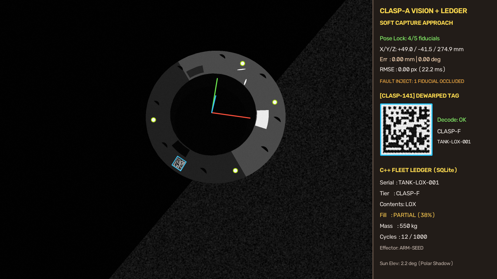
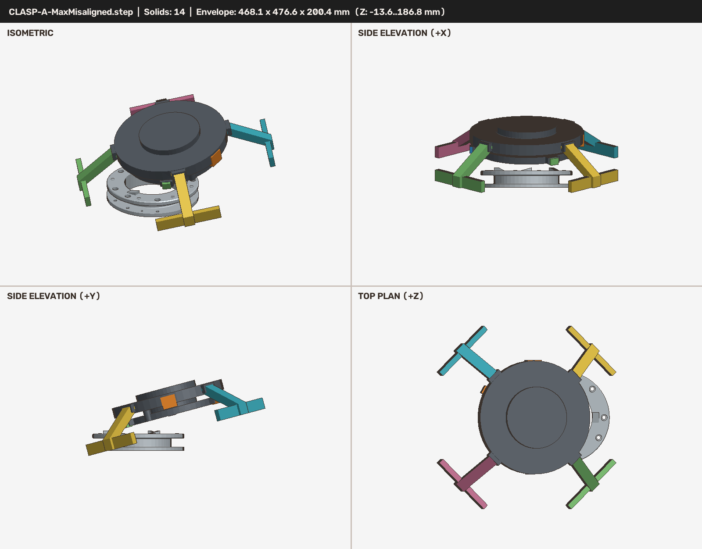

# CLASP — Common Lunar Attachment and Servicing Port

An open, royalty-free passive mechanical, cryogenic fluid, and contactless power/data interface standard (`CLASP-STD-001`) for lunar surface cargo, propellant depots, rovers, and cislunar servicing below crewed IDSS scale.



> **Design Philosophy:** Like the ISO 1161 shipping-container corner casting, all actuation, sensing, illumination, and intelligence reside on the active manipulator (`CLASP-A`). The passive payload port (`CLASP-M`) is dumb metal—zero electrical contacts, zero actuators, and manufacturable for well under `CAD 2,000`.

---

## Interface Tiers (`CLASP-STD-001` Rev A)

All three tiers share a single **`240 mm OD × ≤ 55 mm H`** external footprint, **`8 × M8`** clocked mounting pattern (`210 mm BCD`), external perimeter capture/latch collar, **`3 × 15°`** alignment ramps, **`5`** asymmetric retroreflective fiducials (`[CLASP-140]`), and static laser-etched DataMatrix ID (`[CLASP-141]`):

| Tier | Capability | Mass (`Al 7075-T6`) | Mass Limit | Dust Mitigation |
|---|---|---:|---:|---|
| **`CLASP-M`** | Mechanical capture & structural tie-down (`10 kN` axial, `5 kN` shear, `2.0 kN·m` bend, `1.0 kN·m` torsion) | `2.132 kg` / `2.050 kg` (DFM) | `≤ 3.50 kg` | Passive cover, wiping chamfers, orientation |
| **`CLASP-F`** | `CLASP-M` + `25 mm` coaxial dual-poppet LOX coupling (`2.0 kg/s`, `≤ 5 cm³` trapped volume, `2.0 mm` chilldown bypass) | `3.156 kg` | `≤ 6.00 kg` | + Inductively powered `1 kV` EDS & dry purge |
| **`CLASP-FP`** | `CLASP-F` + `500 W` inductive power (`≥ 85%` eff) + `10 Mbit/s` optical data + non-contact magnetic/mechanical inhibits | `3.689 kg` | `≤ 7.50 kg` | + Inductively powered `1 kV` EDS & dry purge |

---

## Key Repository Deliverables

- **Specification & Verification:**
  - [CLASP-STD-001_RevA_Working_Draft.md](CLASP-STD-001_RevA_Working_Draft.md) ([PDF](CLASP-STD-001_RevA_Working_Draft.pdf) generated via [tools/build_pdf.py](tools/build_pdf.py)) — `62` numbered requirements across `40` sections/subsections.
  - [Annex_A_Verification_Matrix_Draft.md](Annex_A_Verification_Matrix_Draft.md) — Complete Verification Cross-Reference Matrix (`T / A / I / D`).
  - [tools/clasp_check.py](tools/clasp_check.py) — Zero-dependency spec linter, Annex A parity checker, and first-principles sizing script.
- **Parametric CAD (`build123d`):**
  - [cad/clasp_m.py](cad/clasp_m.py) → [cad/CLASP-M.step](cad/CLASP-M.step) (`2.132 kg`, `758.60 cm³`).
  - [cad/clasp_m_dfm.py](cad/clasp_m_dfm.py) → [cad/CLASP-M-DFM.step](cad/CLASP-M-DFM.step) (`2.050 kg`, `729.39 cm³` — 2-setup CNC lathe + top-down 3-axis mill; quoted `$380.02 USD` Qty 1 economy prototype in `6061-T6` vs. `$473.97 USD` baseline).
  - [cad/clasp_fp_packaging.py](cad/clasp_fp_packaging.py) → [cad/CLASP-FP-Packaging.step](cad/CLASP-FP-Packaging.step) (`28/28` zero-overlap 3D B-Rep checks inside the `Ø 148 mm` central bore; `4` tangential `Ti-6Al-4V` flexure thermal-break spokes; `CLASP-F = 3.158 kg`, `CLASP-FP = 3.691 kg`).
  - [cad/clasp_a.py](cad/clasp_a.py) → [cad/CLASP-A-Latched.step](cad/CLASP-A-Latched.step), [cad/CLASP-A-OpenAligned.step](cad/CLASP-A-OpenAligned.step), & [cad/CLASP-A-MaxMisaligned.step](cad/CLASP-A-MaxMisaligned.step) (Annex B active end effector: `4`-jaw `Al 7075-T6` wide-scoop funnel at `45°/135°/225°/315°`, `3` cam followers, `3` `17-4PH H900` over-center latches w/ `R3.5 mm` throat fillet, `5/5` zero-overlap B-Rep checks in hard-latched and `+100 mm / +15°` capture states; `Ø 486.6 mm` keep-out clear above `Z = 18.0 mm`; `4.81 kg` mechanism / `8.40 kg` w/ FP core + camera).
  - [tools/render_step.py](tools/render_step.py) → [cad/renders/](cad/renders/) — Headless 4-view (`Iso / +X / +Y / +Z`) STEP PNG renderer ([CLASP-M-DFM](cad/renders/CLASP-M-DFM_views.png), [CLASP-FP-Packaging](cad/renders/CLASP-FP-Packaging_views.png), [CLASP-A-Latched](cad/renders/CLASP-A-Latched_views.png), [CLASP-A-OpenAligned](cad/renders/CLASP-A-OpenAligned_views.png), [CLASP-A-MaxMisaligned](cad/renders/CLASP-A-MaxMisaligned_views.png)).



- **Structural & Thermoelastic FEA (`gmsh` + `scikit-fem`):**
  - [fea/clasp_m_fea.py](fea/clasp_m_fea.py) — Baseline quadratic `Tet10` 3D FEA (`~92k` DOFs) under `[CLASP-030]`/`[CLASP-031]` (`CLASP-M`: `+3.21` / `+3.37` body MoS @ `+120 °C`; `CLASP-M-DFM`: `+1.48` / `+1.57` @ `+120 °C`).
  - [fea/clasp_m_detailed_fea.py](fea/clasp_m_detailed_fea.py) — `12`-angle clocking sweep with discrete `3`-latch (`22 mm`) & `3`-cam patches, `15 kN/bolt` preloaded `M8` spring-bolts, and active-set `Z = 0` compression-only deck contact (`270°` worst clock = `14.17 kN` single-hook load, `195.8 MPa` @ `TetP2`: **`Al 7075-T6` PASS** `MoS_y = +0.51` hot / `A286` bolts `+0.37` / `0.086 mm` lift-off; `Al 6061-T6` hot `MoS_y = -0.14` → cold benchtop only).
  - [fea/clasp_a_fea.py](fea/clasp_a_fea.py) — Active mechanism `Tet10` FEA: **`17-4PH H900`** latch hooks w/ `R3.5 mm` throat fillet (`14.19 kN` worst hook → `474.0 MPa`, `+120 °C MoS_y = +0.77` / `+0.85` nominal throat), **`Al 7075-T6`** `4`-jaw scoop arms (`4.5 kN` + `1.5 kN` bump/stall → `1.02 mm` tip, `+120 °C MoS_y = +0.66`), and `Ø10 mm` pin / `Ø20 mm` column checks (`MoS_y >= +4.37`).
  - [fea/clasp_thermoelastic_fea.py](fea/clasp_thermoelastic_fea.py) — Coupled `90 K` LOX core vs. `83 K..+120 °C` `[CLASP-151]` heat-conduction + 3D thermoelasticity (`126k` DOFs): `Ti-6Al-4V` tangential flexure spokes keep `0.500 mm` nominal bore gap clear (`0.322–0.609 mm`), cut conductive heat leak `4×` (`12.0 → 3.0 W`), and achieve **`MoS_y = +3.28` (`83 K`) / `+4.96` (`90 K → +120 °C`)**.
- **Polar-Shadow 6-DOF Perception & DataMatrix Demo (`OpenCV` + `zxing-cpp`):**
  - [perception/run_benchmark_and_demo.py](perception/run_benchmark_and_demo.py) → [clasp_polar_capture_demo.mp4](perception/clasp_polar_capture_demo.mp4), [benchmark_results.json](perception/benchmark_results.json).
  - `100`-trial `§5.1` envelope stress test (`±100 mm X/Y`, `250–350 mm Z`, `±15°` pitch/yaw, `±20°` roll, `0.5°–5°` sun elevation, solar glints, and `21` occluded-fiducial trials): **`99.0%`** pose success (`95.24%` occluded), **`95.0%`** DataMatrix decode, **`0.005 mm`** / **`0.004°`** median error.
- **C++20 SQLite / JSON Fleet Ledger (`ledger/`):**
  - [ledger/include/clasp/ledger.hpp](ledger/include/clasp/ledger.hpp), [ledger/src/ledger.cpp](ledger/src/ledger.cpp), [ledger/sql/schema.sql](ledger/sql/schema.sql), [ledger/schema/clasp_port_ledger.schema.json](ledger/schema/clasp_port_ledger.schema.json).
  - Keyed by `[CLASP-141]` `unique_serial`, tracking `payload_contents`, `fill_state`, `cycle_count`, and rated life (`500` / `1,000` cycles).

---

## Quick Verification

```bash
# 1. Spec lint, Annex A parity, and sizing checks
python3 tools/clasp_check.py

# 2. Build and test C++20 fleet ledger (requires libsqlite3-dev)
cmake -S ledger -B ledger/build && cmake --build ledger/build -j
ctest --test-dir ledger/build --output-on-failure

# 3. Run CAD / Visual Render / FEA / Perception pipelines (inside .venv)
python cad/clasp_m_dfm.py
python cad/clasp_fp_packaging.py
python cad/clasp_a.py
python tools/render_step.py cad/CLASP-M-DFM.step cad/CLASP-FP-Packaging.step cad/CLASP-A-Latched.step cad/CLASP-A-OpenAligned.step cad/CLASP-A-MaxMisaligned.step
python fea/clasp_m_fea.py --step cad/CLASP-M-DFM.step --order 2 --lc-min 2.5 --lc-max 7.5
python fea/clasp_m_detailed_fea.py
python fea/clasp_a_fea.py
python fea/clasp_thermoelastic_fea.py
python -m perception.run_benchmark_and_demo
```

---

## License & Contact

The passive port interface specification (`CLASP-STD-001`) and `CLASP-M` geometry are intended for open, royalty-free adoption.  
**Author:** Tyson Fritz (`tysongfritz@gmail.com`) — Nanaimo, BC, Canada.

